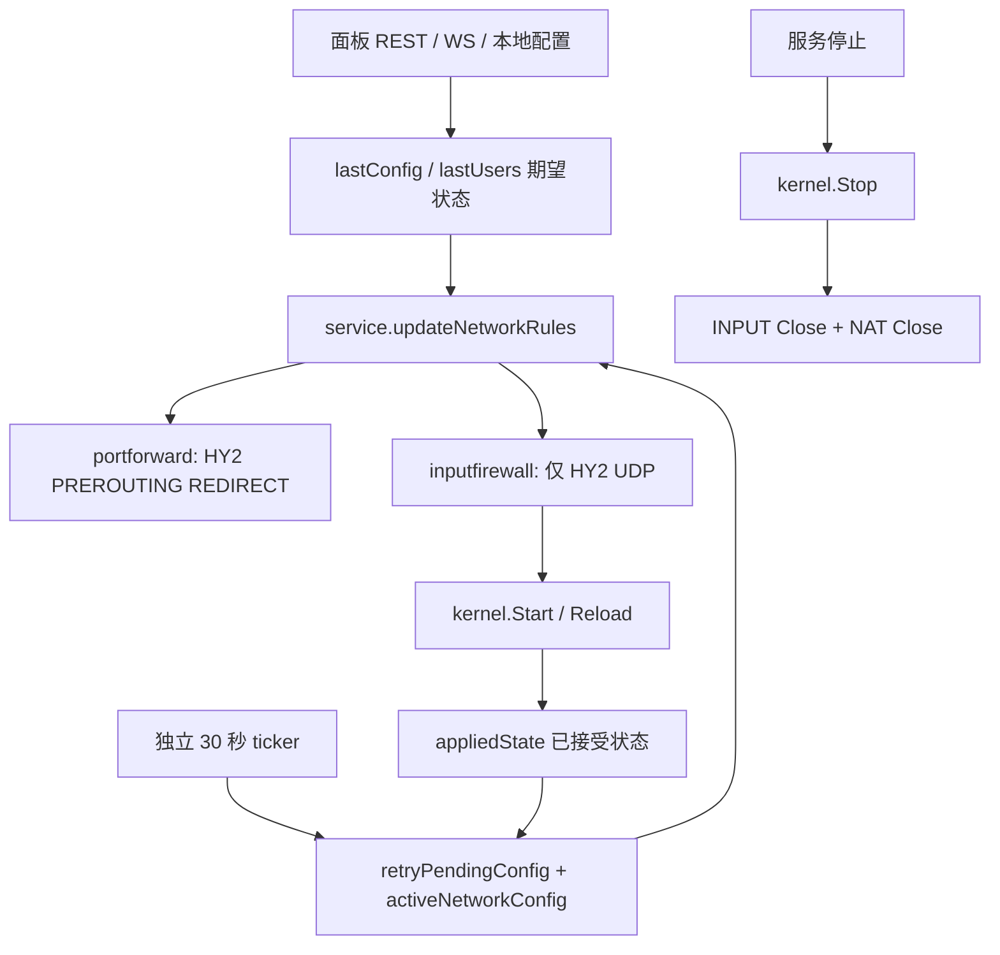
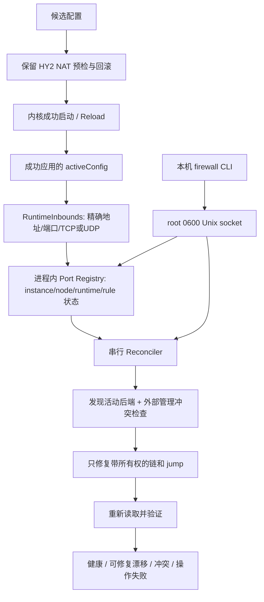

# Firewall Manager：实施前审计与方案

审计日期：2026-10-31。基准为本机独立维护仓库 `node-reference`，origin 为 `ksr-v/Xboard-Node--Custom-Source`，HEAD `39787deee9feccec4cdc368856969befd372facd`，并保留工作区已有 HY2 nft 1.0.6 兼容修复及 service API backoff 修改。此文先于本次功能代码修改完成。行号指实施前代码。

## 已确认的根因

`internal/service/service.go:1045` 确实为入站调用网络规则管理，并非 VLESS 漏调用。`internal/inputfirewall/manager.go:84` 的 `validate()` 对非 `hysteria` / version 2 返回空 listener；同文件 `:290` 的 `desired()` 固定使用 `-p udp`。`internal/inputfirewall/inspect.go:164` 仅允许每条自有链包含一条 UDP ACCEPT 和一条 RETURN。因此 VLESS TCP 443 根本没有规则生成路径，Update(non-HY2) 的原意是移除旧 HY2 规则。启动成功日志只说明内核成功，不能证明外部连接已通过防火墙。

UDP 17443 可以放行，是上述 HY2 专用路径正常工作；无需把端口硬编码进新实现。无法仅凭本地源码确定事故服务器当时运行的二进制摘要和完整内核规则，本报告不冒充事故机现场取证。

## 原有架构与流程

创建：`service.go:788,1008` 先应用 NAT 与 INPUT，再启动/更新内核。INPUT 管理器获得进程级 mutex 和 `/run/xboard-node-managed-input.lock` 独占 flock，读取 nft 库存和已活动 iptables 后端，验证完整所有权，再通过 `iptables-restore --noflush` 仅重建自有链。自有 jump 放在 INPUT 连续自有前缀，优先于宿主规则，未改 INPUT policy。链名 `XB_IN_<owner SHA256 前20hex>`，规则 comment 使用完整摘要 `xboard-node-input:v1:<64hex>`。

删除：`Service.Run` 的 defer 次序先停内核，再调用 `inputFirewall.Close` 和 `portForward.Close`。只精确删除带有匹配所有权的自有规则；独占进程租约允许清理已无存活注册 owner 的旧链，不清理进程内其他节点。机器模式的节点启动/删除在 `internal/machine/machine.go:124,168,198`，复用相同 Service。

原有端口发现：从服务接收的 NodeSpec 取得 HY2 ServerPort/ListenIP，没有通用运行监听接口。两个内核已经在成功启动后保存 `activeConfig`（`singbox/singbox.go:158`、`xray/xray.go:185`），可作为实际生效配置的权威来源。自定义配置合并保护 inbounds，不应重新读取可变文件推测当前监听。

持久化：没有写 `/etc/iptables/rules.v4` 或调用全局 save；现有启动重建和每30秒协调。安装器 `install.sh:1165` 和 xbctl 的 unit 生成只有 network-online 顺序，缺少与宿主防火墙恢复服务的次序协调。

## 其他缺陷与安全边界

- INPUT 在内核启动成功前预装，存在失败候选端口短暂放行；失败会阻止当前节点启动或更新。
- 无多端口、TCP/UDP 共用端口、运行端口注册表、只读诊断和写后验证。
- 原有 discovery 会在 legacy-only 环境优先建立 nft hook，需要按活动路径选择；安装工具本身不能证明该后端活动。
- nft 与 legacy 的过滤 hook 同时活动时，两套都可能丢包，单套 ACCEPT 不能覆盖另一套 DROP。必须显示选择原因，不能仅按 alternatives 或默认命令猜测。
- 原生 nft INPUT base chain、firewalld 的后续 DROP 无法靠兼容链 ACCEPT 安全绕过；UFW 兼容链也必须识别，避免自动插首条规则绕过其策略。此类结构报告冲突，由管理员协调，不接管未知链。
- iptables 合法默认策略是 ACCEPT/DROP；“默认 REJECT”按末尾或中间 REJECT 规则处理。
- 现有 `/healthz` 全接口且无鉴权，不能承载 repair，也不能当作防火墙健康证明。

## 实施方案

1. 内核增加可选运行监听观测接口，从成功快照解析，停止时返回空；未知协议或传输拒绝猜测，明确报告未支持。Shadowsocks 双协议，VLESS/VMess/Trojan依据实际底层传输，HY2/TUIC为UDP。
2. 复用 INPUT Manager 的所有权、锁、事务与补偿，扩展为多条精确 TCP/UDP ACCEPT + RETURN；保留旧 HY2 API 兼容测试和调用。
3. 注册表只发布真实运行端口。INPUT 失败记录警告、周期重试，不因此关闭其他节点；HY2 NAT 的失败/回滚语义保持。
4. `status/check/ports/diagnose` 只读，`repair` 才协调。通过本机 root 私有 Unix socket 请求运行进程，服务停止时报告不可用，不读取过期 JSON 或面板期望配置冒充运行状态。
5. systemd 增加晚于 netfilter-persistent/nftables/ufw 的 `After=`，不强制拉起这些服务。开机在真实入站成功后重建，外部 reload 后每30秒检查并修复；不新增常驻服务，不覆盖宿主持久化文件。

## 预计修改文件与兼容风险

- `internal/kernel` 及双内核：成功快照提取接口与测试。
- `internal/inputfirewall/{manager,inspect,system_linux}.go` 及单测/netns：通用监听、后端选择、外部管理检测、只读报告、写后校验。
- `internal/service/service.go` 及测试：成功后同步 INPUT、注册生命周期、失败重试；保留已有 backoff 修改。
- 新 `internal/firewall`：运行注册表、本机控制与 CLI；`cmd/xboard-node`、`cmd/xbctl` 接线。
- `install.sh`、xbctl unit：启动顺序及通用 INPUT 说明；新增运维/验收文档。

保持面板 API、WS/REST 同步、用户统计、证书、NAT 跳跃和 owner 哈希兼容。新解析器可读取旧 v1 HY2 链；旧二进制不认识新增 TCP/多条链，回滚前必须让新版干净停服清理，再由旧版重建 HY2，TCP需管理员显式管理。保留本地开关与标准 unit 的环境授权，面板仍不能授予防火墙修改权限。

## 验证计划

单测覆盖运行快照、失败候选、生命周期、多owner、端口变更、只读诊断、权限关闭、外部管理冲突、写后失配和100次幂等；现有隔离 netns runner扩展 TCP 外部真实连接与UDP并存。隔离服务器/客户端都不能使用宿主netns，保留宿主规则对照。初始受限沙箱无法访问 WSL，后续通过受审查的只读探测确认本机 Ubuntu 可运行独立命名空间；本次实际执行及最终边界见 [测试报告](FIREWALL-TEST-REPORT.zh-CN.md)，历史日志不计入本次结果。

参考：[nftables 官方链与 verdict 说明](https://wiki.nftables.org/wiki-nftables/index.php/Configuring_chains)、[systemd 官方 unit 顺序说明](https://www.freedesktop.org/software/systemd/man/latest/systemd.unit.html)。
